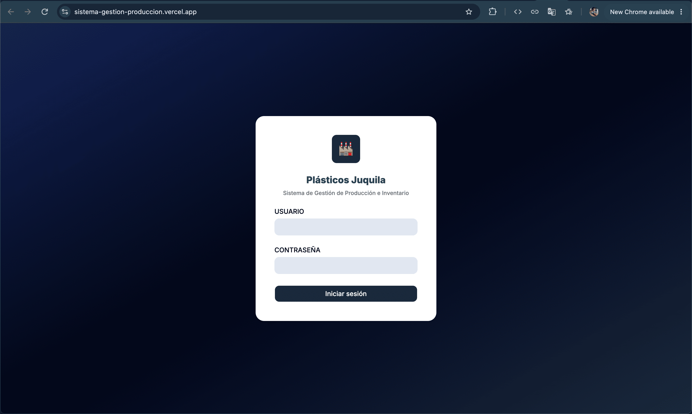
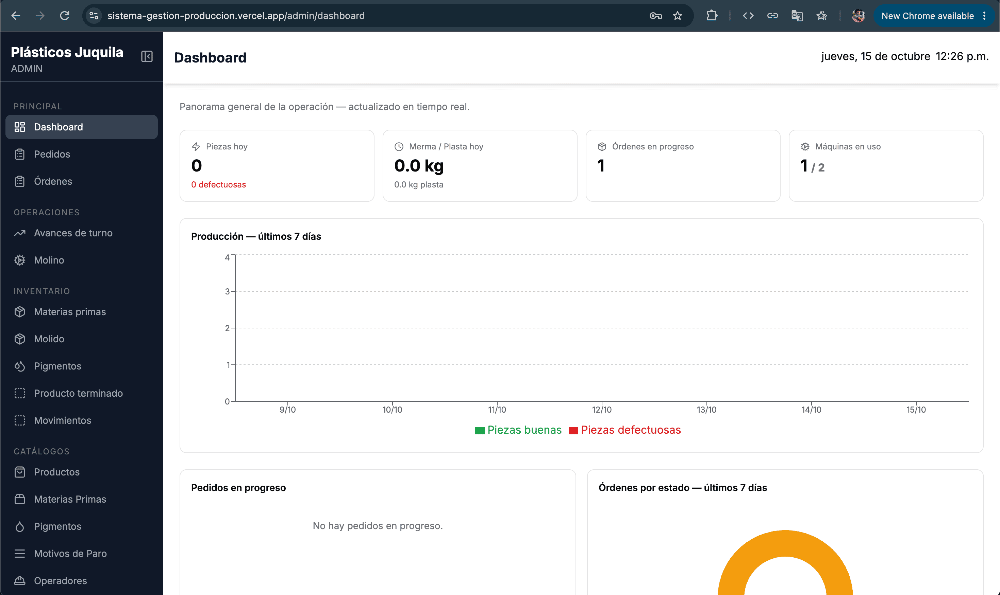
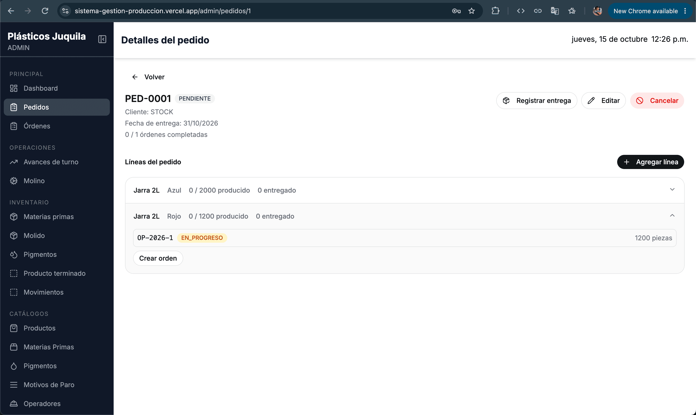
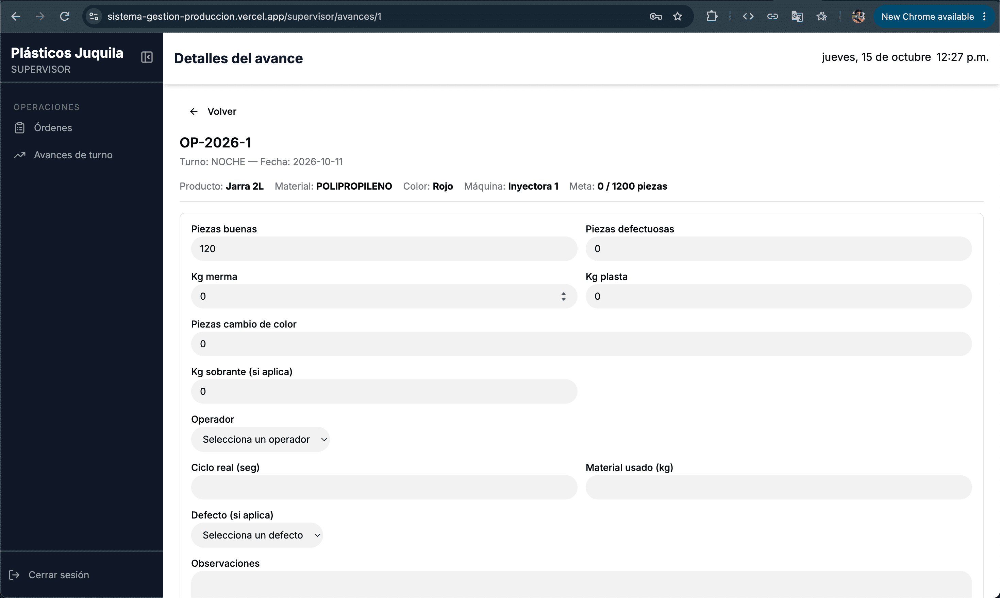
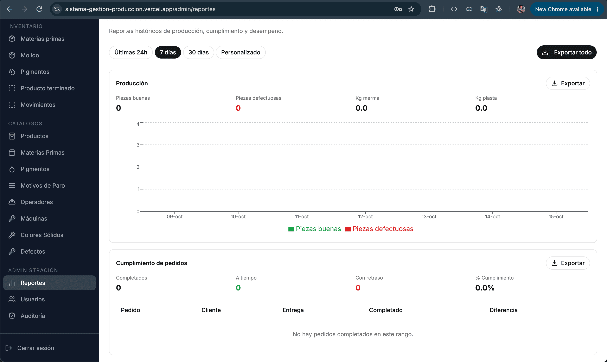
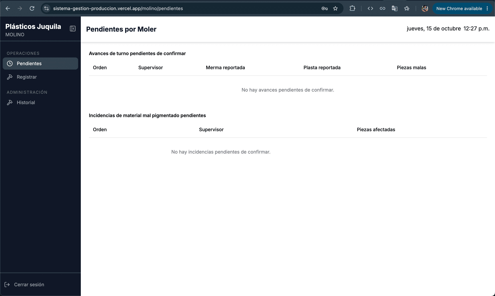
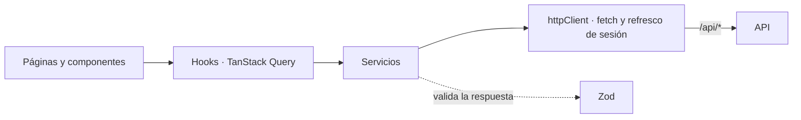

# Sistema de Inventario y Producción — Frontend


## English summary

Single-page web application for an inventory and production management system for a plastic plant. Five role-based profiles (admin, scheduler, shift supervisor, pigments, regrinding) each get only the screens and actions of their job. It consumes the [REST API](https://github.com/danbmz/API-SGPI).

**Live demo:** [Web app](https://sistema-gestion-produccion.vercel.app/) · [Status page](https://stats.uptimerobot.com/XJH1CFhTF5) · [API repository](https://github.com/danbmz/API-SGPI)
Hosted on free tiers: the first request after a quiet period can be slow.

**Demo accounts** (demo data only): `admin01`, `programador01`, `supervisor01`, `pigmentos01`, `molino01` — all use the password `Test1234!`.

**Highlights**

- **Transparent session refresh:** one shared refresh request for all concurrent calls, and an automatic retry of the call that failed.
- **Inactivity logout** with an advance warning that dismisses itself when the user comes back.
- **Role-based routing and navigation** (the API enforces permissions again on its side).
- **Cascading selects** that only offer coherent combinations of material, pigment and product, and inactive catalog items are never offered.
- **Server-side filtering and pagination** for customer orders and the audit log.
- **In-browser Excel export** with SheetJS, as one workbook or per section, with a date-range cap.
- **Privacy-first error monitoring:** Sentry with restricted data collection and no session replay.

**Stack:** React 19 · TypeScript · Vite · Tailwind CSS 4 · shadcn/ui · TanStack Query · Zustand · React Hook Form + Zod · Recharts · Vercel.

**Run it locally:** see section 8 below. The detailed documentation follows in Spanish.

---

## 1. Descripción

Esta interfaz se diseñó a partir de los procesos reales de una fábrica de plásticos. Cada rol (administrador, programador, supervisor, pigmentos y molino) ve únicamente las pantallas y acciones de su puesto. Los datos del demo son ficticios.

Este repositorio contiene el **frontend**. La API está en [este repositorio](https://github.com/danbmz/API-SGPI).

## 2. Demo en vivo

| | |
|---|---|
| Aplicación web | [sistema-gestion-produccion.vercel.app](https://sistema-gestion-produccion.vercel.app/) |
| Estado del servicio | [Página de estado](https://stats.uptimerobot.com/XJH1CFhTF5) |

**Usuarios de prueba.** Todos usan la contraseña `Test1234!`:

| Rol | Usuario | Qué ve |
|---|---|---|
| Administrador | `admin01` | Todo: Dashboard, Reportes, Auditoría, usuarios y catálogos |
| Programador | `programador01` | Pedidos, órdenes y salida de producto terminado |
| Supervisor | `supervisor01` | Órdenes disponibles y avances de turno |
| Pigmentos | `pigmentos01` | Material, sobrantes, solicitudes, incidencias e inventario |
| Molino | `molino01` | Confirmaciones de recepción y moliendas |

> Son datos de demostración. La API corre en un plan gratuito, así que la primera petición tras un periodo sin tráfico puede tardar.

## 3. Capturas

| | |
|---|---|
|  |  |
| **Inicio de sesión** | **Dashboard del administrador:** alertas, indicadores, gráficas y desempeño por operador |
|  |  |
| **Detalle de pedido:** líneas, órdenes asociadas y progreso | **Avance de turno** (supervisor) |
|  |  |
| **Reportes** con rango de fechas y exportación a Excel | **Molino:** pendientes de confirmar y de moler |

## 4. Stack técnico

| Capa | Tecnología |
|---|---|
| Lenguaje y build | TypeScript 6, Vite 8 |
| Interfaz | React 19, Tailwind CSS 4, shadcn/ui (Radix UI), lucide-react |
| Rutas | React Router 7 |
| Datos del servidor | TanStack Query 5 |
| Estado del cliente | Zustand 5 |
| Formularios y validación | React Hook Form 7, Zod 4 |
| Gráficas | Recharts 3 |
| Exportación a Excel | SheetJS (`xlsx`) |
| Notificaciones | Sonner |
| Monitoreo | Sentry (`@sentry/react` 11) |
| Despliegue | Vercel |

## 5. Qué hace

- **Administrador:** Dashboard (alertas, indicadores, gráficas, desempeño por operador y pedidos en progreso); Reportes por rango de fechas con exportación a Excel; Auditoría con filtros; usuarios, catálogos e inventario; supervisión de pedidos y órdenes; vistas de solo lectura de avances de turno y de Molino.
- **Programador:** pedidos con filtro por estado y paginación; detalle de pedido con sus líneas y las órdenes asociadas; creación de órdenes de producción; salida de producto terminado por venta directa o entrega de pedido.
- **Supervisor:** órdenes disponibles, avances de turno abiertos y el formulario de avance, con borrador y cierre.
- **Pigmentos:** órdenes agrupadas por máquina para confirmar material y sustituir material pigmentado; sobrantes pendientes; solicitudes de material e incidencias; entradas de proveedor y ajustes de inventario.
- **Molino:** pendientes de confirmación, pendientes de moler e historial de moliendas.

## 6. Arquitectura y estructura



Cada capa tiene una sola responsabilidad: los componentes no llaman a la API, lo hacen los servicios a través de `httpClient`, y cada respuesta se valida con Zod antes de usarse. Los hooks de TanStack Query se encargan de la caché y de invalidarla después de cada cambio.

```
src/
├── components/ui/      # componentes de shadcn/ui
├── features/           # un directorio por módulo
│   ├── auth/
│   ├── pedidos/
│   ├── ordenes/
│   ├── avancesTurno/
│   ├── pigmentos/
│   ├── molino/
│   ├── inventory/
│   ├── catalogo/
│   ├── usuarios/
│   ├── dashboard/
│   ├── reportes/
│   └── auditLogs/      # cada uno con sus componentes, hooks, schemas y servicios
├── lib/                # httpClient y utilidades de validación
├── router/             # rutas, protegidas por rol
├── shared/             # componentes y páginas compartidos
├── store/              # estado global con Zustand
├── types/              # enumeraciones compartidas con la API
└── utils/
```

## 7. Decisiones técnicas destacadas

- **Sesión renovada de forma transparente.** `httpClient` centraliza todas las peticiones. Cuando la API responde 401, intenta un único refresco de sesión que comparten todas las peticiones simultáneas, y reintenta la original. Si el refresco falla, emite un evento que cierra la sesión.
- **Cierre por inactividad con aviso previo.** Un temporizador que se reinicia con la actividad del usuario (ratón, teclado, clic, scroll o toque). Antes de cerrar muestra un aviso, y ese aviso se descarta solo si el usuario vuelve. El motivo del cierre queda registrado en la auditoría de la API.
- **Rutas y menús por rol.** El router tiene guardas por rol y la navegación solo muestra lo que cada rol puede usar. La API valida los permisos de nuevo, así que ocultar una pantalla no es la única protección.
- **Filtros en cascada.** Los selectores dependientes solo ofrecen combinaciones coherentes de materia prima, pigmento, producto y molido, y los catálogos inactivos nunca se ofrecen. El selector de salida de producto parte del inventario real, muestra el stock disponible y avisa cuando la cantidad lo excede.
- **Paginación y filtros en el servidor.** Los pedidos llegan filtrados por estado (pendientes por defecto) y paginados, y la auditoría se filtra por módulo, usuario y rango de fechas. Así no se descarga el historial completo.
- **Exportación a Excel en el navegador.** SheetJS genera un libro con varias hojas, o una hoja por sección. Las gráficas consultan rangos largos y la API los agrupa por día, semana o mes, y la exportación completa se limita a 90 días.
- **Sentry con privacidad primero.** Recolección de datos restringida (sin datos de usuario, cookies ni cuerpos de petición), sin Session Replay y sin tracing. Solo se activa si existe `VITE_SENTRY_DSN`. Un `ErrorBoundary` muestra un mensaje genérico si un componente falla.

## 8. Cómo correrlo en local

**Requisitos:** Node.js 22.12 o superior, npm y la [API](https://github.com/danbmz/API-SGPI) corriendo (local o remota).

```bash
git clone https://github.com/danbmz/Frontend-SGPI.git
cd Frontend-SGPI
npm install
cp .env.example .env     # revisa los valores (abajo)
npm run dev
```

La aplicación queda en `http://localhost:5173`.

**Variables de entorno**

| Variable | Obligatoria | Descripción |
|---|---|---|
| `VITE_API_URL` | Sí | URL de la API. En local, `http://localhost:3000`; en el despliegue, `/api` |
| `VITE_SENTRY_DSN` | No | Si falta, Sentry queda apagado |

Vite incrusta estas variables al **compilar**, así que cambiarlas exige volver a compilar o redesplegar.

| Comando | Qué hace |
|---|---|
| `npm run dev` | Servidor de desarrollo |
| `npm run build` | Revisa tipos y compila a `dist/` |
| `npm run preview` | Sirve la versión compilada |

## 9. Despliegue

Se despliega en Vercel como proyecto de Vite (directorio de salida `dist`). El archivo `vercel.json` hace dos cosas:

```json
{
  "rewrites": [
    { "source": "/api/:path*", "destination": "https://TU-API.onrender.com/:path*" },
    { "source": "/(.*)", "destination": "/index.html" }
  ]
}
```

- **Reescribe `/api/*` hacia la API.** El navegador solo habla con un dominio, así que las cookies de sesión son del mismo sitio y no hace falta habilitar cookies de terceros.
- **Devuelve `index.html` en cualquier otra ruta**, para que recargar una pantalla interna no dé un 404.

Las variables `VITE_API_URL` (con el valor `/api`) y `VITE_SENTRY_DSN` se configuran en el panel de Vercel. Con un dominio propio, el frontend y la API pueden vivir en subdominios del mismo sitio, y entonces `VITE_API_URL` apunta directamente a la API.

## 10. Problemas conocidos

- **Avisos de `npm audit` en la cadena de `shadcn`.** Hay 7 avisos de severidad alta que vienen de las dependencias de su herramienta de línea de comandos. El único arreglo que ofrece `npm audit` baja `shadcn` a una versión que rompe el proyecto, así que se dejan documentados hasta que `shadcn` publique dependencias corregidas.
- **Tamaño del bundle.** Vite avisa de archivos de más de 500 kB tras la minificación. La mejora prevista es cargar bajo demanda las páginas de Dashboard y Reportes (`React.lazy`) y la librería de Excel (`import()` dinámico).
- **Paginación parcial.** Existe en Pedidos y Auditoría. Órdenes y avances de turno cargan el listado completo filtrado por estado.
- **Sin pruebas automáticas ni CI en el frontend.** El backend sí tiene smoke test en CI.

## 11. Autor y licencia

**Daniel Bermudez** — [LinkedIn](https://www.linkedin.com/in/dev-daniel-bermudez/) · [Correo](mailto:danbmz007@gmail.com)

Este proyecto se distribuye bajo la [licencia MIT](LICENSE).